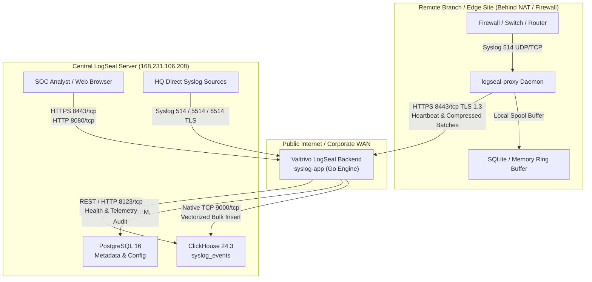

# Valtrivo LogSeal — Network Architecture & Port Specifications

This document defines the complete network architecture, required network ports, communication protocols, and firewall rules for the **Valtrivo LogSeal** Central Ingestion Server, PostgreSQL Metadata Database, ClickHouse High-Throughput Analytical Database, and Distributed Proxy Nodes (`logseal-proxy`).

---

## 1. Executive Summary & Communication Topology

Valtrivo LogSeal uses a distributed, secure dual-engine architecture designed for multi-tenant MSSP operations and strict regulatory compliance (Law No. 5651 & KVKK/GDPR).



---

## 2. Port Matrix Specification

| Port | Protocol | Service / Component | Direction | Binding Scope | Purpose & Description |
| :--- | :---: | :--- | :---: | :--- | :--- |
| **8443** | TCP | Web Dashboard & Edge API | Inbound | `0.0.0.0` (Public / WAN) | **Recommended Web UI & API ingress**. Encrypted with TLS 1.3. Serves the operator web interface, tenant console, and receives edge proxy heartbeats/batches. |
| **8080** | TCP | Web Dashboard (HTTP) | Inbound | `0.0.0.0` (Public / LAN) | Unencrypted HTTP web UI or redirect to HTTPS. Used for internal reverse-proxy ingress or load balancer health checks. |
| **514** | UDP | Syslog Collector (RFC 3164/5424) | Inbound | `0.0.0.0` (Public / LAN) | Primary standard UDP syslog receiver for network switches, firewalls, and Linux/UNIX daemons. |
| **514** | TCP | Syslog Stream (RFC 3164/5424) | Inbound | `0.0.0.0` (Public / LAN) | Connection-oriented TCP syslog stream for reliable packet delivery without dropped UDP datagrams. |
| **5514** | UDP | Syslog Collector (Alternative) | Inbound | `0.0.0.0` (Public / LAN) | Secondary high-throughput UDP syslog listener to segregate high-volume firewall traffic from general server logs. |
| **5514** | TCP | Syslog Stream (Alternative) | Inbound | `0.0.0.0` (Public / LAN) | Secondary TCP syslog listener for designated tenant ingress. |
| **6514** | TCP | Syslog over TLS (RFC 5425) | Inbound | `0.0.0.0` (Public / LAN) | Encrypted TLS Syslog with optional mutual TLS (mTLS) client certificate verification. |
| **5432** | TCP | PostgreSQL Database (App DB) | Internal | `127.0.0.1` (**Loopback Only**) | Relational storage for tenants, user accounts, MFA secrets, SIEM detection rules, MITRE ATT&CK techniques, audit trails, and archive indices. **Never expose externally.** |
| **8123** | TCP | ClickHouse HTTP Interface | Internal | `127.0.0.1` (**Loopback Only**) | ClickHouse HTTP REST interface for container health checks, schema migrations, and admin telemetry. **Never expose externally.** |
| **9000** | TCP | ClickHouse Native Protocol | Internal | `127.0.0.1` (**Loopback Only**) | High-speed vectorized binary TCP protocol used by the Go ingestion pipeline for bulk block inserts up to 100,000+ EPS. **Never expose externally.** |

---

## 3. Database Communication Details

### 3.1. PostgreSQL 16 (Relational Metadata Database)
- **Container Name**: `syslog-postgres`
- **Internal Host**: `postgres` (within Docker bridge network)
- **Host Loopback**: `127.0.0.1:5432`
- **Security Policy**: Strictly bound to `127.0.0.1`. The Docker host firewall blocks external access. Connection from the Go application uses TLS or local Unix socket/bridge network.
- **Stored Data**:
  - Multi-tenant organizations and quotas (`tenants`)
  - Device inventory and authorized IP mappings (`devices`)
  - Edge forwarder proxy nodes and cryptographic bearer tokens (`edge_nodes`)
  - User accounts, PBKDF2/Argon2 password hashes, password histories (`users`, `user_password_histories`)
  - SIEM detection rules, correlation rules, and alerts (`siem_rules`, `siem_alerts`)
  - Synced MITRE ATT&CK enterprise catalog cache (`mitre_catalog_cache`)
  - Tamper-evident administrative audit logs (`audit_logs`)
  - Law 5651 cryptographic timestamped archive ledger (`archive_records`)

### 3.2. ClickHouse 24.3 (High-Speed Columnar Analytical Database)
- **Container Name**: `syslog-clickhouse`
- **Internal Host**: `clickhouse` (within Docker bridge network)
- **Host Loopback**:
  - `127.0.0.1:9000` (Native TCP Protocol)
  - `127.0.0.1:8123` (HTTP Protocol)
- **Security Policy**: Strictly bound to `127.0.0.1`. ClickHouse native password authentication with memory resource governance.
- **Stored Data**:
  - `syslog_events` table: Compressed columnar log storage partitioned by month (`toYYYYMM(timestamp)`).
  - Indexed columns: `timestamp`, `received_at`, `tenant_id`, `host`, `facility`, `severity`, `app_name`, `message`.
  - Supports vectorized LZ4 / ZSTD compression achieving a 10:1 storage ratio compared to raw text logs.

---

## 4. Edge Proxy Node (`logseal-proxy`) Communication Architecture

The `logseal-proxy` daemon is deployed on remote branch offices, subsidiary networks, or customer edge sites where direct WAN syslog streaming is insecure or unreliable.

### 4.1. Edge Node Inbound Ports (Remote LAN)
- **UDP `514` & TCP `514`**: Listens for syslog packets generated by firewalls, routers, switches, and servers within the local branch LAN.
- **Allowed CIDRs Governance**: The proxy enforces tenant-configured CIDR whitelists (e.g. `10.0.0.0/8`, `192.168.1.0/24`) before buffering logs.

### 4.2. Edge Node Outbound Egress to Central Main Server (WAN)
- **Destination**: `https://<CENTRAL_SERVER_IP>:8443`
- **Protocol**: HTTPS / TLS 1.3 (TCP port 8443)
- **Authentication**: Bearer Token Authorization header:
  ```http
  Authorization: Bearer <edge_node_secret_token>
  ```
- **Endpoints Used**:
  1. `POST /api/v1/edge/heartbeat`:
     - Transmitted every 10–60 seconds (configurable per node).
     - Reports node health metrics: CPU utilization, memory footprint, disk buffer utilization, active EPS, and drop count.
     - Receives cloud configuration updates: dynamic sync intervals, allowed CIDR changes, and token rotation signals.
  2. `POST /api/v1/edge/batch`:
     - Transmitted in compressed `gzip` streams when batch threshold (default: 500 events or 1 second) is reached.
     - Enforces payload integrity check and cryptographic tenant mapping.
- **NAT / Firewall Traversal**:
  > [!IMPORTANT]
  > **Zero Inbound Port Forwarding Required**: Because the proxy initiates all connections outbound to port `8443/tcp`, no inbound firewall ports or NAT pinholes need to be opened on the customer router or edge firewall!

### 4.3. Disconnect Resilience & Disk Spooling
- If WAN connectivity to the central server is interrupted, `logseal-proxy` automatically shifts log storage into an on-disk SQLite FIFO queue (`/var/spool/logseal/spool.db`).
- Once the WAN connection is restored, the daemon flushes spooled logs with rate throttling to prevent overloading the central server while guaranteeing **zero packet loss**.

---

## 5. Host Firewall Configuration Examples

### 5.1. Ubuntu / Debian (`ufw`)
To configure the central server firewall using `ufw`:

```bash
# 1. Allow SSH management
sudo ufw allow 22/tcp comment "SSH Remote Administration"

# 2. Allow Web UI and Edge API
sudo ufw allow 8443/tcp comment "LogSeal HTTPS Web & Edge API"
sudo ufw allow 8080/tcp comment "LogSeal HTTP Web"

# 3. Allow Standard and Alternative Syslog Ingestion
sudo ufw allow 514/udp comment "LogSeal Syslog UDP"
sudo ufw allow 514/tcp comment "LogSeal Syslog TCP"
sudo ufw allow 5514/udp comment "LogSeal Syslog Alt UDP"
sudo ufw allow 5514/tcp comment "LogSeal Syslog Alt TCP"
sudo ufw allow 6514/tcp comment "LogSeal Syslog TLS"

# 4. Verify Databases are NOT exposed (should NOT be allowed in UFW)
# Ports 5432, 8123, 9000 must remain blocked from public interfaces

# 5. Enable firewall
sudo ufw enable
sudo ufw status verbose
```

### 5.2. RHEL / Rocky Linux / AlmaLinux (`firewalld`)
To configure using `firewalld`:

```bash
# Add Web and API ports
sudo firewall-cmd --permanent --add-port=8443/tcp
sudo firewall-cmd --permanent --add-port=8080/tcp

# Add Syslog Ingestion ports
sudo firewall-cmd --permanent --add-port=514/udp
sudo firewall-cmd --permanent --add-port=514/tcp
sudo firewall-cmd --permanent --add-port=5514/udp
sudo firewall-cmd --permanent --add-port=5514/tcp
sudo firewall-cmd --permanent --add-port=6514/tcp

# Reload firewall
sudo firewall-cmd --reload
sudo firewall-cmd --list-ports
```

---

### 5.3. Bare-Metal (Native Linux) Specific Port & Security Architecture

When Valtrivo LogSeal is deployed in **Bare-Metal (No Docker)** mode via `install_standalone.sh`:
- **Native PostgreSQL (`postgresql.service`)**:
  - Bound to `127.0.0.1:5432` in `/etc/postgresql/<version>/main/postgresql.conf` (`listen_addresses = '127.0.0.1'`).
  - UFW explicitly denies external connections (`ufw deny 5432/tcp`).
- **Native ClickHouse Server (`clickhouse-server.service`)**:
  - Bound to loopback via `/etc/clickhouse-server/config.d/listen_local.xml`:
    ```xml
    <clickhouse>
        <listen_host>127.0.0.1</listen_host>
        <listen_host>::1</listen_host>
    </clickhouse>
    ```
  - Native port `9000` and HTTP port `8123` are unreachable from external interfaces (`ufw deny 9000/tcp`, `ufw deny 8123/tcp`).
- **Native Application Daemon (`syslog-platform.service`)**:
  - Runs with Linux capabilities `AmbientCapabilities=CAP_NET_BIND_SERVICE`, allowing the unprivileged process to bind privileged ports `514/udp` and `514/tcp` without requiring root permissions.
  - Listens on `0.0.0.0:8080`, `0.0.0.0:8443`, `0.0.0.0:514`, `0.0.0.0:5514`, and `0.0.0.0:6514`.

---

## 6. Connectivity Testing & Troubleshooting

### Test Syslog UDP Ingestion from Client:
```bash
# Send test RFC 3164 packet
logger -n <SERVER_IP> -P 514 -d -p local0.info "Valtrivo LogSeal UDP Port 514 Verification Test"
```

### Test Syslog TCP Ingestion:
```bash
# Send test TCP stream
echo "<14>$(date '+%b %d %H:%M:%S') test-host test-app: Valtrivo TCP Port 514 Test" | nc -w 2 <SERVER_IP> 514
```

### Verify Local Database Port Bindings on Central Server:
```bash
# Check that 5432, 8123, and 9000 are bound ONLY to 127.0.0.1
ss -tulpn | grep -E ':(5432|8123|9000|8443|8080|514|5514)'
```

#### Docker Deployment Output:
```text
tcp   LISTEN 0      128        127.0.0.1:5432         0.0.0.0:*    users:(("docker-proxy"...))
tcp   LISTEN 0      128        127.0.0.1:8123         0.0.0.0:*    users:(("docker-proxy"...))
tcp   LISTEN 0      128        127.0.0.1:9000         0.0.0.0:*    users:(("docker-proxy"...))
tcp   LISTEN 0      128          0.0.0.0:8443         0.0.0.0:*    users:(("docker-proxy"...))
tcp   LISTEN 0      128          0.0.0.0:8080         0.0.0.0:*    users:(("docker-proxy"...))
udp   UNCONN 0      0            0.0.0.0:514          0.0.0.0:*    users:(("docker-proxy"...))
tcp   LISTEN 0      128          0.0.0.0:514          0.0.0.0:*    users:(("docker-proxy"...))
```

#### Bare-Metal (Native Systemd) Output:
```text
tcp   LISTEN 0      128        127.0.0.1:5432         0.0.0.0:*    users:(("postgres"...))
tcp   LISTEN 0      128        127.0.0.1:8123         0.0.0.0:*    users:(("clickhouse-serv"...))
tcp   LISTEN 0      128        127.0.0.1:9000         0.0.0.0:*    users:(("clickhouse-serv"...))
tcp   LISTEN 0      128          0.0.0.0:8443         0.0.0.0:*    users:(("syslog-platform"...))
tcp   LISTEN 0      128          0.0.0.0:8080         0.0.0.0:*    users:(("syslog-platform"...))
udp   UNCONN 0      0            0.0.0.0:514          0.0.0.0:*    users:(("syslog-platform"...))
tcp   LISTEN 0      128          0.0.0.0:514          0.0.0.0:*    users:(("syslog-platform"...))
```
In both architectures, `5432`, `8123`, and `9000` are bound exclusively to `127.0.0.1`, guaranteeing zero external exposure.
