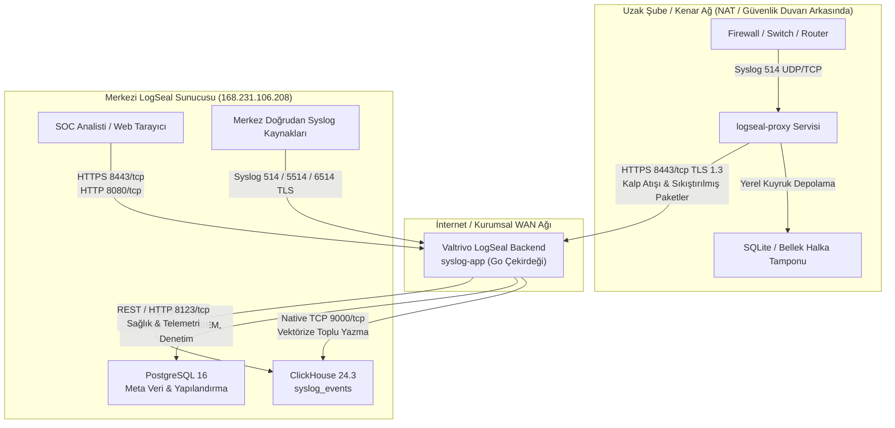

# Valtrivo LogSeal — Ağ Mimarisi ve Port Gereksinimleri

Bu doküman, **Valtrivo LogSeal** Merkezi Toplama Sunucusu, PostgreSQL İlişkisel Veritabanı, ClickHouse Yüksek Hızlı Analitik Veritabanı ve Dağıtık Proxy Düğümleri (`logseal-proxy`) için ağ mimarisini, gerekli portları, iletişim protokollerini ve güvenlik duvarı (firewall) kurallarını tanımlar.

---

## 1. Yönetici Özeti ve İletişim Topolojisi

Valtrivo LogSeal, çok kiracılı (MSSP) mimarisi ve yasal mevzuata (5651 Sayılı Kanun, KVKK, GDPR) tam uyumlu çift motorlu (dual-engine) dağıtık bir yapı kullanır.



---

## 2. Port Matrisi ve İletişim Protokolleri

| Port | Protokol | Servis / Bileşen | Yön | Dinleme Kapsamı | Amaç ve Açıklama |
| :--- | :---: | :--- | :---: | :--- | :--- |
| **8443** | TCP | Web Arayüzü & Edge API | Giriş (Inbound) | `0.0.0.0` (Genel / WAN) | **Önerilen Web Arayüzü ve API Girişi**. TLS 1.3 ile şifrelenmiştir. Operatör web panelini, kiracı konsolunu ve uzak proxy düğümlerinin veri aktarımını sunar. |
| **8080** | TCP | Web Arayüzü (HTTP) | Giriş (Inbound) | `0.0.0.0` (Genel / LAN) | Şifresiz HTTP web arayüzü veya HTTPS yönlendirmesi. Dahili ters vekil (reverse proxy) veya yük dengeleyici sağlık kontrolü için kullanılır. |
| **514** | UDP | Syslog Toplayıcı (RFC 3164/5424) | Giriş (Inbound) | `0.0.0.0` (Genel / LAN) | Ağ anahtarları, güvenlik duvarları ve Linux sistemleri için birincil standart UDP syslog dinleyicisi. |
| **514** | TCP | Syslog Akışı (RFC 3164/5424) | Giriş (Inbound) | `0.0.0.0` (Genel / LAN) | Güvenilir paket teslimi ve UDP paket kayıplarını engellemek için bağlantı temelli TCP syslog akışı. |
| **5514** | UDP | Alternatif Syslog (UDP) | Giriş (Inbound) | `0.0.0.0` (Genel / LAN) | Yüksek hacimli firewall loglarını genel sunucu loglarından ayırmak için alternatif UDP syslog portu. |
| **5514** | TCP | Alternatif Syslog (TCP) | Giriş (Inbound) | `0.0.0.0` (Genel / LAN) | Belirlenen kiracı veya cihaz grupları için ikincil TCP syslog dinleyicisi. |
| **6514** | TCP | TLS Üzerinden Syslog (RFC 5425) | Giriş (Inbound) | `0.0.0.0` (Genel / LAN) | Karşılıklı istemci sertifikası doğrulamalı (mTLS) uçtan uca şifreli güvenli syslog dinleyicisi. |
| **5432** | TCP | PostgreSQL Veritabanı | Dahili (Internal) | `127.0.0.1` (**Yalnızca Loopback**) | Kiracılar, kullanıcı hesapları, MFA sırları, SIEM kuralları, MITRE ATT&CK matrisi, denetim izleri ve arşiv indeksleri. **Dış ağa ASLA açılmamalıdır.** |
| **8123** | TCP | ClickHouse HTTP Arayüzü | Dahili (Internal) | `127.0.0.1` (**Yalnızca Loopback**) | Sağlık kontrolü, şema güncellemeleri ve REST telemetri sorguları. **Dış ağa ASLA açılmamalıdır.** |
| **9000** | TCP | ClickHouse Native Protokolü | Dahili (Internal) | `127.0.0.1` (**Yalnızca Loopback**) | Go çekirdeğinin 100.000+ EPS hızında vektörize toplu yazma yaptığı ikili (binary) protokol. **Dış ağa ASLA açılmamalıdır.** |

---

## 3. Veritabanı İletişim Detayları

### 3.1. PostgreSQL 16 (Uygulama ve Meta Veri Veritabanı)
- **Konteyner Adı**: `syslog-postgres`
- **Dahili Ana Bilgisayar**: `postgres` (Docker dahili ağ köprüsü)
- **Host Loopback**: `127.0.0.1:5432`
- **Güvenlik Politikası**: Yalnızca `127.0.0.1` adresine bağlıdır. Dış ağdan doğrudan erişim engellenmiştir.
- **Saklanan Veriler**:
  - Kiracı organizasyonları ve kotalar (`tenants`)
  - Yetkili cihaz envanteri ve IP filtreleri (`devices`)
  - Uzak Proxy Düğümleri ve kriptografik taşıyıcı belirteçler (`edge_nodes`)
  - Operatör hesapları, parola geçmişleri, MFA anahtarları (`users`, `user_password_histories`)
  - SIEM tespit kuralları ve güvenlik alarmları (`siem_rules`, `siem_alerts`)
  - MITRE ATT&CK teknik kataloğu (`mitre_catalog_cache`)
  - Yöneticilerin sistem değişiklik denetim logları (`audit_logs`)
  - 5651 zaman damgalı arşiv kayıt defteri (`archive_records`)

### 3.2. ClickHouse 24.3 (Yüksek Hızlı Analitik Log Deposu)
- **Konteyner Adı**: `syslog-clickhouse`
- **Dahili Ana Bilgisayar**: `clickhouse` (Docker dahili ağ köprüsü)
- **Host Loopback**:
  - `127.0.0.1:9000` (Native TCP Protokolü)
  - `127.0.0.1:8123` (HTTP Protokolü)
- **Güvenlik Politikası**: Kesinlikle `127.0.0.1` adresine sınırlandırılmıştır.
- **Saklanan Veriler**:
  - `syslog_events` tablosu: Aylık partisyonlu (`toYYYYMM(timestamp)`) sütunsal sıkıştırılmış kayıtlar.
  - İndeksler: `timestamp`, `received_at`, `tenant_id`, `host`, `facility`, `severity`, `app_name`, `message`.
  - Vektörize LZ4 / ZSTD sıkıştırma ile ham loglara kıyasla 10:1 oranında disk tasarrufu sağlar.

---

## 4. Uzak Proxy Düğümleri (`logseal-proxy`) ile Merkez Sunucu İletişimi

`logseal-proxy` arka plan servisi, uzak şubelerde, fabrika lokasyonlarında veya müşteri yerleşkelerinde internet üzerinden doğrudan syslog iletimi güvenli olmadığında devreye girer.

### 4.1. Proxy Düğümünün Yerel Dinleme Portları (Şube İçi LAN)
- **UDP `514` & TCP `514`**: Yerel şubedeki firewall, switch ve router'lardan gelen logları dinler.
- **İzin Verilen CIDR Denetimi**: Kiracı bazlı tanımlanan IP aralıkları (örn. `10.0.0.0/8`, `192.168.1.0/24`) dışındaki paketleri kenarda filtreler.

### 4.2. Proxy Düğümünden Merkez Sunucuya Giden İletişim (WAN)
- **Hedef Sunucu**: `https://<MERKEZ_SUNUCU_IP>:8443`
- **Protokol**: HTTPS / TLS 1.3 (TCP 8443)
- **Kimlik Doğrulama**: Bearer Token başlığı:
  ```http
  Authorization: Bearer <edge_node_secret_token>
  ```
- **Kullanılan Uç Noktalar**:
  1. `POST /api/v1/edge/heartbeat`:
     - Her 10–60 saniyede bir iletilir.
     - Düğüm sağlık verilerini raporlar (CPU, RAM, Disk Kuyruk Doluluğu, Anlık EPS, Düşen Paket).
     - Buluttan dinamik yapılandırma alır (CIDR listesi güncellemesi, belirteç rotasyonu).
  2. `POST /api/v1/edge/batch`:
     - Toplu paket eşiğine ulaşıldığında (varsayılan: 500 olay veya 1 saniye) `gzip` ile sıkıştırılmış olarak gönderilir.
     - Kriptografik bütünlük doğrulaması ile kiracıya işlenir.
- **Güvenlik Duvarı & NAT Geçişi**:
  > [!IMPORTANT]
  > **Dışarıdan İçeriye Port Açma Zorunluluğu Yoktur (Sıfır Port Yönlendirme)**: Proxy servisi merkez sunucuya tüm bağlantıları çıkış (outbound) yönünde TCP 8443 üzerinden başlattığı için müşteri modeminde veya şube firewall'unda hiçbir port açılması (port forwarding) gerekmez!

### 4.3. Hat Kesintisi Dayanıklılığı (Disk Kuyruğu - Spooling)
- WAN bağlantısı koptuğunda `logseal-proxy` logları yerel SQLite disk kuyruğuna (`/var/spool/logseal/spool.db`) yazar.
- İnternet geri geldiğinde, kuyruktaki loglar sunucuyu yormayacak hız kontrolüyle (rate-limiting) merkeze aktarılır ve **sıfır veri kaybı** sağlanır.

---

## 5. Güvenlik Duvarı (Firewall) Yapılandırma Örnekleri

### 5.1. Ubuntu / Debian (`ufw`)
Merkez sunucu güvenlik duvarı kurulumu:

```bash
# 1. SSH Yönetimini Açın
sudo ufw allow 22/tcp comment "SSH Uzak Yonetim"

# 2. Web Arayüzü ve Edge API Portlarını Açın
sudo ufw allow 8443/tcp comment "LogSeal HTTPS Web ve Edge API"
sudo ufw allow 8080/tcp comment "LogSeal HTTP Web"

# 3. Standart ve Alternatif Syslog Portlarını Açın
sudo ufw allow 514/udp comment "LogSeal Syslog UDP"
sudo ufw allow 514/tcp comment "LogSeal Syslog TCP"
sudo ufw allow 5514/udp comment "LogSeal Syslog Alt UDP"
sudo ufw allow 5514/tcp comment "LogSeal Syslog Alt TCP"
sudo ufw allow 6514/tcp comment "LogSeal Syslog TLS"

# 4. Veritabanlarının dışarıya KAPALI olduğunu teyit edin (5432, 8123, 9000 UFW'ye EKLENMEMELİDİR)

# 5. Güvenlik Duvarını Etkinleştirin
sudo ufw enable
sudo ufw status verbose
```

### 5.2. RHEL / Rocky Linux / AlmaLinux (`firewalld`)
```bash
sudo firewall-cmd --permanent --add-port=8443/tcp
sudo firewall-cmd --permanent --add-port=8080/tcp
sudo firewall-cmd --permanent --add-port=514/udp
sudo firewall-cmd --permanent --add-port=514/tcp
sudo firewall-cmd --permanent --add-port=5514/udp
sudo firewall-cmd --permanent --add-port=5514/tcp
sudo firewall-cmd --permanent --add-port=6514/tcp
sudo firewall-cmd --reload
sudo firewall-cmd --list-ports
```

---

## 6. Port Test ve Doğrulama Komutları

### İstemciden UDP 514 Syslog Testi:
```bash
logger -n <SUNUCU_IP> -P 514 -d -p local0.info "Valtrivo LogSeal UDP Port 514 Dogrulama Paketi"
```

### İstemciden TCP 514 Syslog Testi:
```bash
echo "<14>$(date '+%b %d %H:%M:%S') test-host test-app: Valtrivo TCP Port 514 Testi" | nc -w 2 <SUNUCU_IP> 514
```

### Sunucu Üzerinde Port Bağlantılarını Kontrol Etme:
```bash
ss -tulpn | grep -E ':(5432|8123|9000|8443|8080|514|5514)'
```
Burada `5432`, `8123` ve `9000` portlarının yalnızca `127.0.0.1` dinlediği görülmelidir.
